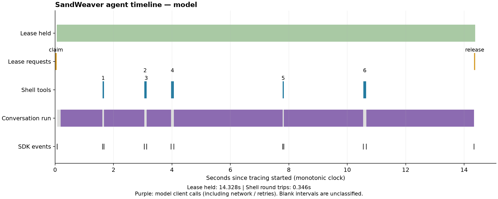

# DeepSeek Flash agent 行为观测实验报告

实验日期：2026-11-10。单次真实模型运行，人工构造的小型 Python 修复任务。

## 主要结果

Agent 修复区间合并函数后，独立重跑 5 项测试全部通过。一次租约持续 **14.328 秒**，其中 6 次模型客户端调用合计 **13.776 秒，占 96.15%**；6 次 shell 往返合计 **0.346 秒，占 2.41%**。本次观测采用全会话持租，模型调用期间一直持有 worker。

这次观测支持把“模型调用开始”作为执行资源归还的候选信号。它没有验证释放策略的收益：没有并发竞争任务，没有实际归还再领，也没有 CPU、进程或 syscall 观测。96.15% 是模型客户端调用与租约重叠的时间比例，不能当作可回收资源比例或吞吐提升。

绿色表示已确认取得至归还完成的租约区间；紫色表示模型客户端调用；蓝色编号对应下面六次 shell 操作。SDK 事件是回调时刻，不能代替内部调度或系统调用轨迹。各行存在包含关系，不能相加计算总耗时。

## 实验设置与测量边界

| 项目 | 设置 |
|---|---|
| 模型 | OpenRouter `deepseek/deepseek-v4-flash`；SDK 使用 `openrouter/deepseek/deepseek-v4-flash` |
| Agent | 外置 OpenHands SDK 1.59.0，Python 3.12；shell 工具连接 SandWeaver |
| Worker | 本机 OrbStack，Docker demo 镜像，池 min=max=1 |
| 镜像 ID | `sha256:37a3c702065ee52b8fc6c33238cd83e103cd10d9f0ba58ca144c8fcbffba599d` |
| 工作负载 | 修复 `merge_intervals`：重叠、相接、无序、空输入、不得修改输入 |
| 初始实现 | `return intervals`；五项 unittest，要求先检查和测试，再修改和重测 |
| 样本与预热 | 1 次模型运行；无模型预跑；缓存 demo 镜像，启动 worker 完成后开始客户端观测 |
| 运行上限 | 最多 8 次 agent 迭代，每次输出上限 2048 token；SDK 请求尝试次数 1；外部超时 240 秒 |
| 策略 | 全会话持有同一租约，未启用 I/O 卸载、动态归还、suspension 或 snapshot |

时间来自客户端单调时钟。起点在打开 trace 时，终点为 release 响应后的标记；不包括 Docker 启动、镜像准备、Python 启动、SDK 导入和独立验收。模型耗时含 SDK 处理和网络，不是服务端纯推理耗时；shell 耗时含命令执行和通信，不是 CPU 时间。首次启动因 Docker daemon 未运行而失败，发生在模型调用之前；启动 Docker 后才产生本文唯一的模型样本。

SDK 保存的 `stats.usage_to_metrics` 为空，未取得可靠 token 用量或实际账单，因此不报告费用估算。上述限制约束迭代、输出和重试，不是美元硬预算。

## 时序与任务结果

| Shell 序号 | 开始时间（秒） | 往返（毫秒） | 操作 | 退出码 |
|---|---:|---:|---|---:|
| 1 | 1.624 | 46.18 | 查找工作区文件 | 0 |
| 2 | 3.057 | 49.64 | 读取待修复函数 | 0 |
| 3 | 3.107 | 26.78 | 读取五项测试 | 0 |
| 4 | 3.971 | 90.74 | 运行原始测试，观察失败 | 1 |
| 5 | 7.792 | 34.73 | 写入排序、复制并合并的实现 | 0 |
| 6 | 10.552 | 97.74 | 重新运行测试 | 0 |

第 4 次非零退出是预期的缺陷复现，不是调度失败。检查保存的六条命令，未发现修改测试的操作。Agent 结束后，在宿主临时工作区独立运行同一组测试，5/5 通过；该验证仅覆盖上述五项契约，不代表完整算法或安全证明。

六次模型客户端调用依次耗时 1.434、1.379、0.830、3.727、2.719、3.687 秒。第二次返回后执行了两次 shell 调用，两次 exec 的区间不重叠：单次模型输出多个工具动作，并不意味着本后端并行执行。

| 度量 | 实测 |
|---|---:|
| Trace 起点至归还完成 | 14.382 秒 |
| Claim 请求往返 | 53.87 毫秒 |
| 租约取得至归还完成 | 14.328 秒 |
| Conversation.run | 14.270 秒 |
| 模型客户端调用合计 | 13.776 秒 |
| Shell 往返合计 | 345.80 毫秒 |
| 租约内其他时间（差额，含归还） | 206.42 毫秒 |
| Release 请求往返 | 39.61 毫秒 |
| SDK 回调 | 15 次：1 SystemPrompt、2 Message、6 Action、6 Observation |

模型区间与 shell 区间在本轨迹中不重叠，二者加“其他时间”与租约区间对齐。39.61 毫秒只是这一次归还的成本，53.87 毫秒只是初始 claim，不能替代竞争条件下重新领租约的成本。

## 对虚拟沙盒设计的启示

**先利用 agent 前端明确提供的阶段信号。** 当前外置客户端已经知道模型请求开始、工具动作到达、工具执行结束和会话结束。前端无需预测模型内容，就能通知后端自己进入了模型等待阶段。本次六段模型调用均长于 0.8 秒，足以提出下一轮资源交接实验，但不能据此确定通用阈值。

**逻辑会话、持久文件和执行租约应分开管理。** 本次任务的结果保存在工作区文件中，模型状态在外部 SDK 中；这使得按工具批次领用匿名 worker 成为合理候选。当前 release 会清理进程及私有写层，真正切换时还必须保护逻辑工作区的独占权，不能简单释放所有所有权后允许另一个会话修改同一路径。

**“工具结束”不等于“进程状态可以销毁”。** 本次命令没有主动启动后台服务，但 trace 没有进程存活检测。前端可以提供状态需求声明，例如仅依赖文件、需要常驻服务或存在未完成工具；后端仍须验证可验证的条件，并在不确定时保留执行资源。前端信号是调度输入，不能直接成为隔离保证。

**本实验不支持 syscall I/O 卸载的性能结论。** 工作负载没有下载，也没有 syscall 拦截。当前模型网络请求本就发生在 worker 之外，长占用来自全会话租约策略。下载入口拦截、任务暂存区、异步完成与重新挂载，需要另做包含真实下载等待的实验。

## 后续验证

本次观测提出了会话独占工作区、执行 worker 按工具批次租用的设计。后续已接通 OpenHands，并用固定工具序列及本地模拟模型验证交接，结果见 [租约策略对照](worker-reuse.md#openhands-租约策略对照)。

还需用多条真实任务的模型间隔和工具序列做容量受限的回放，比较排队、会话完成、worker 租用时间和交接次数，再用有预算限制的真实 agent 验证。

还需加入需要常驻进程的任务，检验系统是否能正确拒绝归还；加入下载任务，验证专属暂存区和完成发布。它们分别决定“何时可安全复用”和“I/O 外移是否有效”，不应由当前小型纯文件任务代替。

## 证据、复现与限制

- 观测实现：[agent.py](../sandweaver/agent.py)、[trace.py](../sandweaver/trace.py)。图由 [plot-agent-trace.py](../benchmarks/plot-agent-trace.py) 从原始 trace 生成。
- 复现脚本：[observe-model-agent.py](../benchmarks/observe-model-agent.py)。本次使用相同工作负载的临时脚本运行；入库版本改为从环境读密钥、接收输出目录，并在独立验收前恢复原始测试文件。入库版本未再次付费运行。
- 详细入口见 [运行与验证](operations.md#agent-时间线)。原始会话和 trace 保留在本机仓库外，不提交 Git；图和汇总允许随报告保存。
- 轨迹标识：`3805fa36620b480b88921a333cbdeee7`；trace SHA-256：`77e7ec99dcca86f56c6372b8bb575a700a848fd1e6261203ebfa18f0209f5bb6`。
- 本轮生成的会话文件扫描未发现 OpenRouter 密钥前缀；这只是针对本次已知凭据格式的检查。
- 回归验证：Docker demo 集成 smoke 通过，覆盖同 worker 接力、私有文件与后台服务清理、工作区保持、重叠租约拒绝、1→2→1 扩缩池和两次固定 SDK 工具调用；退休失败路径单元测试通过。

样本只有一个，不能给出可靠分位数、模型间排名、生产隔离结论或相对 baseline 的提升。此前 GPT-4.1 mini 运行保留在[历史实验记录](experiments.md#真实-agent-时间线观测)，没有混入本报告的 DeepSeek Flash 结果。
