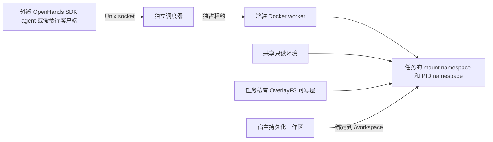

# 设计与实现

## 设计目标

让 agent 会话、项目文件、执行器和任务临时状态各自拥有合适的生命周期。用户间歇回访时，会话历史与项目文件可以留在容器外。执行环境只在实际有需求时分配，完成后复用 worker。默认按实际需求分配，无需预测下一条命令。

| 状态 | 所在位置 | 生命周期 |
|---|---|---|
| 对话、工具结果、LLM 配置 | 外置 agent。SDK 记录写到 agent 状态目录 | 可以跨 worker 存在。当前 CLI 每次运行新建 conversation，没有公开的跨 CLI 恢复入口 |
| 项目文件 | 宿主目录，租约内挂到 `/workspace` | 随项目保留。普通文件修改不依赖容器写层 |
| 预装工具和依赖 | 从 Docker 镜像提取的只读基础文件树 | 随 worker 使用。每个 scheduler 实例固定一个镜像 ID |
| 任意全局安装、`/tmp`、用户目录写入 | 当前租约的 OverlayFS 可写层 | 归还时丢弃 |
| 后台进程和监听端口 | 当前租约的 PID namespace，worker 网络关闭 | 同租约内可继续使用，归还后不保留 |
| 模型供应商的 prompt/KV cache | 模型供应商 | 与 Docker 状态分开。当前实现不控制也不测量其留存 |

## 控制面和协议

`sandweaver.scheduler` 管理 worker 和工作区租约。`sandweaver.agent` 在客户端进程里构建 OpenHands SDK Agent，通过 `sandweaver_shell` 发送命令。Docker worker 不持有模型密钥。模型可通过 `LLM_MODEL`、`LLM_API_KEY` 和可选的 `LLM_BASE_URL` 配置。

协议是 Unix socket 上逐行 JSON，权限为 0600。连接可以发送：

| 操作 | 字段 | 成功结果 |
|---|---|---|
| `status` | 无 | `total`、`leased`、`idle` |
| `claim` | `workspace` | `worker` |
| `exec` | `command` | `stdout`、`stderr`、`exit_code` |
| `release` | 无 | `released` |

请求包含 `op` 字段。异常用 `error` 返回。单连接至多持有一个租约。服务端在连接关闭时执行归还。工作区解析后必须位于配置根目录内；相同、父子重叠工作区在同一个 scheduler 内不能同时租出。这不协调其他进程或 scheduler 对同一目录的写入。

## 分配、执行和归还

1. 启动时解析镜像 ID，用临时容器导出 rootfs，并预热 `--min` 个 worker。每个 worker 把导出内容解到自己的 `/basis`。当前实现按 worker 拷贝基础文件树，未实现 worker 之间的额外共享挂载或去重。
2. 有空闲 worker 就租出。没有空闲且未达到 `--max` 时现场补 worker。满池用条件变量等待，默认等待预算约 30 秒。创建和回收 worker 目前会占用池锁，等待预算不能视为严格服务级别承诺。
3. 建立新的 mount namespace 和 PID namespace。OverlayFS 把 `/basis` 作为 lowerdir，临时可写层放在最多 512 MiB 的 worker tmpfs 下。挂入该任务的 `/workspace` 和少量设备，启动租约的锚进程。
4. 每次执行用 Docker exec 调用可信辅助程序，经 `nsenter` 进入同一任务空间，以 `setpriv` 降权后执行 shell。普通命令用新的 shell，因此磁盘和后台进程能跨调用保留，shell 局部变量与当前目录不会自动延续。
5. 归还时杀掉该 PID namespace 的锚进程，等待退出并删除任务目录。重置失败或命令超时则淘汰 worker。若 Docker 暂时无法确认容器已删除，维护线程会重试，期间该 worker 仍计入已租出数量，原工作区及重叠目录继续拒绝新租约。健康 worker 回到 idle。维护线程按空闲时间回收超过最低数量的 worker，并尝试补足最低数量。

池的最低数量指 worker 总数下限，不是每种环境额外预留的空闲数。当前没有公平排队、租约 TTL、磁盘环境目录、多镜像选择或跨重启恢复。正常退出会清理 worker，进程被强制杀死后可能需要人工回收带 `sandweaver-` 前缀的残留容器。

## 信任和恢复边界

这个原型面向可信本地任务。worker 的挂载辅助程序使用 `SYS_ADMIN` 和放宽的 seccomp 配置。命令经过降权，worker 无外网，但这些措施尚未验证为对抗不可信租户的隔离边界。整个配置工作区根目录挂在 worker 的管理层，任务视图只绑定所选目录。要支持对抗性任务，需要独立验证路径解析、目录替换竞争、挂载传播、文件描述符、IPC、资源限制和宿主侧凭据。

更换可写层可以消除测试覆盖的文件残留。更换 PID namespace 可以结束测试覆盖的后台服务。跨租约需要服务状态时，应明确持久化和重建，或先保留原租约。没有实现进程快照、透明恢复、共享外部数据库重置和 CRIU/Firecracker 后端。
