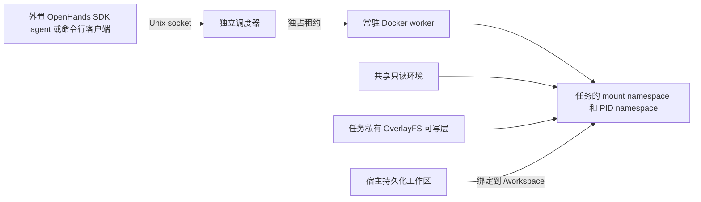

# 设计与实现

## 设计目标

在保证项目状态恢复正确、达到目标吞吐和尾延迟的前提下，用尽可能少的 worker 支撑多轮 coding agent。用达标所需的最小 worker 上限和累计 worker-seconds 衡量执行容量。

## 目标设计

- **Session 是持久的项目工作区。** 一个 session 可以包含多个文件和目录，也可以绑定多个 agent 会话。各会话维护自己的对话历史、工具请求和执行结果，共享所属 session 的项目文件与依赖清单。
- **Worker loop 从队列领取工作。** 队列项包括 agent 会话的工具批次和 session 的依赖准备任务。第一版沿用工作区独占语义，同一 session 的工具批次串行领租。一个会话归还 worker 后，其他会话可以领用该 session 的工作区。下一批领租时读取当时的项目状态。worker 完成任务并清理后回池。
- **最小基础镜像和可增长的共享依赖缓存。** 基础镜像提供启动、隔离和执行命令所需的环境。Python、Rust 等工具链和项目依赖通过组件组装。可以按 session 当前项目状态提前排队准备，也可以从运行中的实际安装结果补充缓存。准备任务在同一个 worker 池执行，构建完成并验证后发布只读组件，归还 worker。

详见 [依赖准备、挂载与发布](lease-and-dependencies.md#按清单组装环境)。

## 当前实现

当前调度器按 Unix socket 连接持有工作区预留。即使原连接已归还 worker，其他连接也无法预留同一工作区。多会话绑定、按批次交接同一 session 工作区、显式任务队列和共享依赖缓存均待实现。以下为现有 worker 池和租约行为。

| 状态 | 所在位置 | 生命周期 |
|---|---|---|
| 对话、工具结果、LLM 配置 | 外置 agent。SDK 记录写到 agent 状态目录 | 可以跨 worker 存在。当前 CLI 每次运行新建 conversation，没有公开的跨 CLI 恢复入口 |
| 项目文件 | 宿主目录，租约内挂到 `/workspace` | 随项目保留。普通文件修改不依赖容器写层 |
| 必要产物和可重建缓存 | 放在工作区或由调用方明确管理 | 工作区内的数据跨 worker 保留。独立会话缓存层和配额淘汰仍是设计提案 |
| 预装工具和依赖 | 从 Docker 镜像提取的只读基础文件树 | 随 worker 使用。每个 scheduler 实例固定一个镜像 ID |
| 任意全局安装、`/tmp`、用户目录写入 | 当前租约的 OverlayFS 可写层 | 归还时丢弃 |
| 后台进程和监听端口 | 当前租约的 PID namespace，worker 网络关闭 | 同租约内可继续使用，归还后不保留 |
| 模型供应商的 prompt/KV cache | 模型供应商 | 与 Docker 状态分开。当前实现不控制也不测量其留存 |

## 控制面和协议

`sandweaver.scheduler` 管理 worker 和工作区租约。`sandweaver.agent` 在客户端进程里构建 OpenHands SDK Agent，通过 `sandweaver_shell` 发送命令。Docker worker 不持有模型密钥。模型可通过 `LLM_MODEL`、`LLM_API_KEY` 和可选的 `LLM_BASE_URL` 配置。

协议是 Unix socket 上逐行 JSON，权限为 0600。连接可以发送：

| 操作 | 字段 | 成功结果 |
|---|---|---|
| `status` | 无 | `total`、`leased`、`idle` |
| `reserve` | `workspace` | `reserved` |
| `claim` | 普通连接传 `workspace`，已预留的连接省略 | `worker` |
| `exec` | `command` | `stdout`、`stderr`、`exit_code` |
| `park` | 已预留工作区且持有 worker | `parked` |
| `release` | 无 | `released` |

请求包含 `op` 字段。异常用 `error` 返回。单连接至多持有一个 worker 租约和一份会话工作区预留。归还 worker 后，预留持续到连接关闭。服务端在连接关闭时先归还 worker，再结束预留。若无法确认旧容器已移除，旧 worker 继续阻止重叠路径被领用。工作区解析后必须位于配置根目录内。同一个 scheduler 拒绝与已有租约或预留相同、父子重叠的工作区。其他进程或 scheduler 对同一目录的访问由使用方协调。

`park` 把当前租约标记为可回收，并要求原连接先重新 `claim` 才能执行命令。池满且没有空闲 worker 时，领用者可以触发清理，回收顺序按标记时间。重新领用与启动清理由同一把池锁协调。清理期间旧工作区仍受租约保护。

## 分配、执行和归还

1. 启动时解析镜像 ID，用临时容器导出 rootfs，并预热 `--min` 个 worker。每个 worker 把导出内容解到自己的 `/basis`。当前实现按 worker 拷贝基础文件树，未实现 worker 之间的额外共享挂载或去重。
2. 有空闲 worker 就租出。没有空闲且未达到 `--max` 时现场补 worker。满池时可以回收已标记的租约，或用条件变量等待，默认等待预算约 30 秒。扩池创建和维护删除仍可能占用池锁。按需回收的 reset 在池锁外执行，等待预算仍受 Docker 调用耗时影响。
3. 建立新的 mount namespace 和 PID namespace。OverlayFS 把 `/basis` 作为 lowerdir，临时可写层放在最多 512 MiB 的 worker tmpfs 下。挂入该任务的 `/workspace` 和少量设备，启动租约的锚进程。
4. 每次执行用 Docker exec 调用可信辅助程序，经 `nsenter` 进入同一任务空间，以 `setpriv` 降权后执行 shell。普通命令用新的 shell，因此磁盘和后台进程能跨调用保留，shell 局部变量与当前目录不会自动延续。
5. 归还时杀掉该 PID namespace 的锚进程，等待退出并删除任务目录。重置失败或命令超时则淘汰 worker。若 Docker 暂时无法确认容器已删除，维护线程会重试，期间该 worker 仍计入已租出数量，原工作区及重叠目录继续拒绝新租约。健康 worker 回到 idle。维护线程按空闲时间回收超过最低数量的 worker，并尝试补足最低数量。

池的最低数量指 worker 总数下限，不是每种环境额外预留的空闲数。当前没有公平排队、租约 TTL、磁盘环境目录、多镜像选择或跨重启恢复。正常退出会清理 worker，进程被强制杀死后可能需要人工回收带 `sandweaver-` 前缀的残留容器。

## 信任和恢复边界

这个原型面向可信本地任务。worker 的挂载辅助程序使用 `SYS_ADMIN` 和放宽的 seccomp 配置。命令经过降权，worker 无外网，但这些措施尚未验证为对抗不可信租户的隔离边界。整个配置工作区根目录挂在 worker 的管理层，任务视图只绑定所选目录。要支持对抗性任务，需要独立验证路径解析、目录替换竞争、挂载传播、文件描述符、IPC、资源限制和宿主侧凭据。

当前 `EXEC` 在进入租约根目录后调用该视图的 `/usr/bin/setpriv`，bounding set 只保留 `CAP_DAC_OVERRIDE`、`CAP_FOWNER` 和 `CAP_CHOWN`，清除其余 capabilities 并设置 `no-new-privs`，仍以 root UID/GID 运行。保留这三项是为了让命令既能写宿主用户所有的工作区，也能像 SWE-bench 官方镜像那样以 root 安装依赖。早期版本清除全部 capabilities，在原生 Linux（WSL2 Arch）上因工作区属于宿主用户而无法写入，现有 smoke 在此失败。早期结果取自 macOS OrbStack，推测其文件共享层的属主映射掩盖了这个问题，未单独验证。代价是租约内的 root 可以绕过工作区内文件的权限位；租约仍看不到其他工作区，没有 `SYS_ADMIN`，网络和 PID 隔离不变。把执行及降权入口放到任务无法改写的可信侧是待做的安全改造。

连接关闭时，调度器在该连接的所有租约都已重置之后，把它用过的工作区里属于 uid 0 或 gid 0 的文件 chown 回工作区目录的属主，然后才释放会话预留。没有预留的单次租约在归还和 chown 之间不受保护。chown 失败只记录日志，不影响已完成的归还。

更换可写层可以消除测试覆盖的文件残留。更换 PID namespace 可以结束测试覆盖的后台服务。跨租约需要服务状态时，应明确持久化和重建，或先保留原租约。没有实现进程快照、透明恢复、共享外部数据库重置和 CRIU/Firecracker 后端。

按租约组装依赖的候选设计与 Docker 原型见 [执行容量与依赖管理](lease-and-dependencies.md#按清单组装环境)。
