# Agent 会话资源与状态的 characterization 方案

状态：**设计提案，部分实施**。worker 侧采样器和扩展后的边界快照已实现并通过冒烟测试（见“插桩”）；已用按记录等待回放的方式完成 10 条轨迹的无 API 试点（见“无 API 试点”）。DeepSeek Flash 实时运行尚未开始，token 字段核对仍待 OpenRouter 凭据。现有真实轨迹只有 [DeepSeek Flash 观测报告](agent-observation.md) 中的 1 次运行（14.328 s 租约，6 次模型调用）。

## 为什么先做 characterization

[研究交接](handoff.md) 的核心问题是依赖恢复成本是否会改变回收决策，这一点尚无数据。已有证据也提示风险：humanize 小包挂载比离线重装只省约 166 ms，而模型等待通常为秒级；[固定容量重放](research.md#算法复现与固定容量重放) 在 2/4、4/8 无抖动场景下三种策略的恢复 P95 相同。

候选方向包括推理与 sandbox 联合调度、状态感知回收、依赖恢复、sandbox 复用完整性、云桌面的渲染和内存密度。它们依赖同一批未知量：会话各阶段占着什么资源、实际用了什么、释放后会丢掉什么、恢复要付多少。本方案用一轮插桩的真实运行同时回答这些问题，再据此选题。

## 研究问题

| RQ | 问题 | 服务的候选方向 |
|---|---|---|
| RQ1 阶段结构 | 模型等待、工具执行、用户等待的时长分布，每批工具数量，到达是否成簇 | 全部 |
| RQ2 占用与使用 | 每个阶段 sandbox 的 CPU、匿名内存、page cache、磁盘写入：占用量与实际使用量 | 联合调度、内存密度 |
| RQ3 状态依赖 | 进入模型等待时若释放 worker 会丢失的状态：后台进程、监听端口、`/tmp`、环境变量、overlay 写层大小与内容类别、依赖增量 | 状态感知回收、复用完整性 |
| RQ4 恢复成本 | 在该边界释放后恢复到可继续工作的成本：重装、重启服务、重新构建 | 依赖恢复、联合调度 |
| RQ5 GPU 侧占用 | 工具执行期间每个会话的 KV cache 占用，按 token 数乘所选模型每 token KV 字节数估算 | 联合调度 |
| RQ6 跨会话重叠 | 任务间依赖重叠（lockfile 相似度），以及写入共享缓存的比例 | 依赖缓存、复用完整性 |

RQ5 是估算值，不是推理服务端实测。OpenRouter 不暴露服务端 KV 驻留，需要自建 vLLM 或 SGLang 才能实测。

**每 token KV 字节数（估算，未经服务端验证）。** 依据官方 [DeepSeek-V4-Flash `config.json`](https://huggingface.co/deepseek-ai/DeepSeek-V4-Flash/raw/main/config.json)：43 层，单个共享 KV 头，`head_dim` 512，每层有 128 token 的滑动窗口；`compress_ratios` 中 20 层为 4、20 层为 128、3 层为 0（只有滑动窗口）；压缩比为 4 的层另有 `index_head_dim` 128 的索引键。按 vLLM 和 LMCache 使用的 fp8 KV（每维 1 字节，忽略缩放因子）计算：

- 随上下文增长的部分约为 20 × (512 + 128) / 4 + 20 × 512 / 128 ≈ 3.3 KB/token；按 bf16 计约翻倍；
- 与长度无关的滑动窗口部分约为 43 × 128 × 512 B ≈ 2.8 MB/序列。

例如 50k token 的会话约占 165 MB 加 2.8 MB。供应商实际使用的精度和缓存策略未知，结果只能作为量级参考。

## 决策图

核心图以每个模型等待边界为一个点：横轴为该次等待时长，纵轴为在此刻释放后的恢复成本（RQ4）。按 RQ3 着色为“可安全释放”和“存在活状态”。

| 观察结果 | 解读 | 后续方向 |
|---|---|---|
| 多数点远低于对角线且可安全释放 | 回收本身不是难题 | 看 RQ5；若 KV 占用远大于 sandbox 占用，转向推理与 sandbox 联合调度 |
| 大量点存在活状态 | 安全释放边界是主问题 | 状态感知回收，RQ3 的状态分类本身构成贡献 |
| 大量点接近或高于对角线 | 恢复成本足以影响决策 | 继续“恢复成本指导回收”主线 |

对角线只是直观参照。是否值得回收还取决于竞争强度，后续需用重放量化。

## 插桩

**客户端（已有）。** [trace.py](../sandweaver/trace.py) 已记录模型和工具区间，`Trace.model_usage` 已从响应中提取 prompt、completion、cache read/write token 和供应商费用。本轮只需核对 DeepSeek Flash 经 OpenRouter 时这些字段是否非空；上次观测中 SDK 的 `usage_to_metrics` 为空。

**Worker 侧采样器（已实现，未经大规模运行）。**

- [sampler.py](../sandweaver/sampler.py) 在宿主机上按固定周期读取 worker 容器 cgroup v2 的 `cpu.stat`、`memory.current`、`memory.stat`（anon、file、shmem）和 `io.stat`。采样器不进入租约，不会在待释放状态里留下进程或文件。
- 粒度是 worker 容器的 cgroup，不是租约。当前租约只是 worker 内的 PID 和 mount namespace，没有独立 cgroup；一个 worker 同一时刻只承载一个租约，因此容器 cgroup 近似租约，但同时计入 worker 自身的 `sleep` 和已解压 basis 的 page cache。分析时以首条命令前的样本为基线。
- 时间戳用 `time.monotonic_ns()`，与回放和 trace 客户端在同一主机上共用时钟，无需偏移。
- 边界快照由调度器的 `inspect` 产生，现包含：租约内进程名、这些进程监听的 TCP 端口（按 socket inode 匹配 `/proc/net/tcp{,6}`）、写层文件数和字节数、两级路径前缀，以及写层字节按 `python_packages`、`node_modules`、`package_cache`、`build_output`、`tmp`、`other` 的分类。只记录路径类别与大小，不读文件内容。
- 回放脚本以 `--sample SECONDS` 开启采样，逐命令记录 CPU、I/O 增量和内存峰值，原始样本写入 `samples.jsonl`。
- 依赖增量（`pip freeze` 差异、lockfile 差异）尚未实现。

**首次试测（1 条轨迹，仅验证工具链）。** `jqlang__jq-2598` 的 DeepSeek 3.2 轨迹前 12 步，session 策略，100 ms 周期：实测平均周期 0.100 s，单次读取约 0.48 ms（约占 0.5% 个核），28 个样本无错误。worker cgroup 的 `memory.current` 约 710 MB，其中 anon 只有 0.4 到 3 MB，其余主要是 basis 的 file 页。这说明按 `memory.current` 统计的“占用”会被 page cache 主导，RQ2 必须分开报告 anon 与 file。单样本不足以支持任何分布结论。

## 无 API 试点：按记录等待回放（2026-11-15）

**方法。** 不调用在线模型。回放 10 条 SWE-bench Multilingual 上 DeepSeek 3.2（mini-swe-agent v2）的公开轨迹，覆盖 9 种语言：laravel、tokio、jq、axios、rubocop、lombok、caddy、fmt、vue、redis。每一步前按轨迹记录的模型等待时长原样休眠（`--wait-scale 1`，不设上限），session 策略全程持有租约，采样周期 100 ms。命令和顺序来自轨迹，agent 不会对环境差异做出反应。机器为 `gpu-wsl`；试点期间全量回放同时运行，命令耗时可能偏大，CPU 时间与内存受影响较小。汇总见 [characterization-pilot-results.json](../benchmarks/characterization-pilot-results.json)，由 [summarize-characterization.py](../benchmarks/summarize-characterization.py) 生成。

**采样器。** 10 次运行共 126,438 个样本，无读取错误，实测周期 0.100 s，单次读取 0.39 到 0.47 ms。

| RQ | 指标 | 结果 |
|---|---|---|
| RQ1 | 回放的等待与执行总时长 | 等待 11,105 s，执行 1,415 s，执行占 11.3% |
| RQ1 | 单次等待（725 个边界） | p50 7.9 s，p90 33.0 s，最大 189 s |
| RQ2 | 等待期间 worker CPU 利用率 | p50 0.3%，p90 0.7%，最大 1.4% |
| RQ2 | 等待期间 anon 内存峰值 | p50 2.7 MB，最大 10.5 MB |
| RQ2 | 等待期间 file 页峰值 | p50 422 MB，p90 877 MB，最大 1.32 GB |
| RQ2 | 命令期间 anon 内存峰值 | p50 2.7 MB，p90 68 MB，最大 1.58 GB |
| RQ3 | 等待开始时的租约状态 | 725 个边界中 288 个无可丢失状态，206 个仅有写层文件，231 个有活进程（其中 8 个有监听端口） |
| RQ3 | 有活进程的等待时长占比 | 5,811 s / 11,105 s（52%） |
| RQ3 | 写层大小 | p50 188 B，p90 306 MB，最大 508 MB（caddy 的 Go 模块缓存，归入 `package_cache`） |

**观察。**

- 等待期间 sandbox 几乎不用 CPU，anon 内存只有几 MB，但命令期间峰值可达 1.58 GB（MB、GB 均按 2 的幂计）。按峰值预留时，大部分租约时间里资源闲置。
- `memory.current` 主要由 basis 的 file 页构成，可回收，不能直接当作占用。
- 活进程不是少数情况：redis（`redis-server`、测试进程，端口 6379）、vue（`esbuild`、`vitest`、`node`）、axios（`node`、`tail`）、caddy（`go`）都在等待开始时留下进程。按等待时长计，超过一半的空闲时间带着活状态。
- 按“决策图”一节，这一结果指向“状态感知回收”。但 Crab 已按轮次状态选择 checkpoint 粒度，AgentSysBench 已在模型等待期间卸载沙盒，因此该方向缺少新的机制成分，见[相关工作矩阵](research.md#相关工作矩阵2026-11-15-核对)。恢复成本（RQ4）尚未测量，决策图的纵轴仍缺失。

**限制。** 10 条轨迹，同一模型提交；等待时长来自原始云端运行，不是本机推理；活进程只记录进程名，未区分仍有用的服务和遗留进程；worker cgroup 包含 worker 自身进程和 basis page cache。

**恢复成本（离线）。** 对每个边界快照，在新 worker 上从干净状态执行恢复，计时到下一条验证命令通过。恢复手段分别测：本地 wheel 或缓存重装、恢复会话私有已装目录、挂载共享只读环境、重启后台服务。这一步不进入实时路径，不影响 RQ1、RQ2 的测量。

**隐私。** 按 [相关工作与研究计划](research.md#agent-行为与前端信号) 的约定，调度轨迹默认只记录标识、阶段、耗时和计数，原始提示词、命令输出和凭据不入库。快照中的文件内容只记录路径类别与大小。

## 工作负载

- 模型：OpenRouter DeepSeek Flash（`deepseek/deepseek-v4-flash`），按仓库约定不替换。
- 约 50 个任务，三类：
  1. 真实 Python 仓库修复任务，带真实依赖，候选来源为 SWE-bench Lite；
  2. 需要常驻开发服务器的 web 任务；
  3. 需要安装、升级或回退依赖的任务。
- 外部校验：用 [FreeInference Agentic Trace](https://huggingface.co/datasets/harvardMadsys/freeinference_agentic_trace) 的请求间隔检查 RQ1 分布的代表性。用户等待无法由单 agent 任务测得，只能由该数据补充。
- 云桌面方向（渲染与编码开销、桌面内存）放到第二期，候选负载为 OSWorld 子集，不与本轮混合。

## 排期与验收

| 阶段 | 内容 | 完成标准 |
|---|---|---|
| 第 1 周 | 实现 worker 侧采样器，10 个任务试点 | 采样开销可接受；各边界快照可与客户端区间对齐；token 字段非空 |
| 第 2 周 | 扩展到约 50 个任务，离线测恢复成本 | 产出决策图、状态分类表、RQ1/RQ2/RQ5 分布，并据此选定方向 |

## 架构对照：独立 sandbox 加挂起，还是共享 worker 池（设计提案，2026-11-19）

状态：**设计提案，未实现，未测量**。

**动机。** 挂起意味着沙盒身份与 agent 一对一绑定，这是 E2B pause、AgentSysBench 卸载、Crab 和 DeltaBox 采用的模型（见[相关工作矩阵](research.md#相关工作矩阵2026-11-15-核对)）。SandWeaver 采用另一种模型：worker 是匿名算力，会话只带走工作区，归还后 worker 交给其他会话。两种架构的取舍：

| | A：每个 agent 独立 sandbox，等待时挂起 | B：共享 worker 池（SandWeaver 现状） |
|---|---|---|
| 资源从哪里省 | 宿主层面：冻结、回收页缓存、换出 | 归还 worker，由其他会话使用 |
| 隔离 | 没有顺序复用，不存在上一租户残留 | 依赖 reset 正确并在失败时 fail closed；跨租户安全性未验证 |
| 部分挂起的含义 | 原地缩小：丢弃可重建缓存，冻结进程，写层保留 | 把必要状态写入会话目录后归还 worker |

[无 API 试点](#无-api-试点按记录等待回放2026-11-15)中，等待期间 worker 的 anon 内存 p50 为 2.7 MB、最大 10.5 MB，CPU p50 为 0.3%；file 页 p50 为 422 MB，属于可回收的页缓存。如果这一量级在更多轨迹上成立，在“单机加容器”的设定下，A 架构冻结空闲 sandbox 的内存代价很小，B 的池化相对 A 的收益可能有限，还要额外承担复用的隔离风险。这是由试点数据推出的假设，两种架构尚未在同一负载上对照。

**假设。**

- H1：容器 sandbox 下，在相同内存预算内，A（冻结）能同时保持的会话数不少于 B。
- H2：B 只在每个 sandbox 有较大且冻结后仍不能释放的固定开销时胜出，例如 microVM 的客户机内核与内存、桌面会话的进程内存，以及每个 sandbox 一份的基础镜像页缓存。
- H3：A 的恢复延迟（解冻）低于 B（领用、reset、恢复会话状态），差距在有活进程或大型私有缓存的边界上最大。

**对照组。**

| 组 | 做法 | 现状 |
|---|---|---|
| A-hold | 每个会话一个容器，全程运行 | 等同于现有 `session` 策略 |
| A-freeze | 每个会话一个容器，模型等待期间 `docker pause`（cgroup freezer），工具到达前 `docker unpause` | 未实现 |
| A-shrink | 在 A-freeze 基础上，挂起前丢弃可重建缓存并请求回收页缓存 | 未实现；回收手段待定 |
| B-batch | 每步归还 worker，写层丢弃 | 现有 `batch` 策略 |
| B-batch-cache | 在 B-batch 基础上，把 `GOCACHE`、`GOMODCACHE`、`npm_config_cache`、`PIP_CACHE_DIR` 指到会话私有挂载目录 | 未实现 |

缓存只在会话内保留，不跨会话共享。跨租户共享可写缓存有投毒风险，CI 中已有实际案例（[GitHub Actions 缓存投毒](https://adnanthekhan.com/2024/05/06/the-monsters-in-your-build-cache-github-actions-cache-poisoning/)），不在本轮评估范围内。

**负载。** SWE-bench Multilingual 公开轨迹，按记录等待回放（`--wait-scale 1`），采样周期 100 ms。为测量密度，需要多个会话同时运行，并错开开始时间。现有 [replay-swebench-all.py](../benchmarks/replay-swebench-all.py) 只能串行执行，需要新的并发驱动。并发数从低到高递增，直到达到内存或磁盘上限。

**指标。**

| 指标 | 计量边界 |
|---|---|
| 宿主内存 | 所有 sandbox cgroup 的 anon 与 file 页之和，加上调度器进程；file 页与 anon 分开报告 |
| 磁盘 | 写层、会话缓存目录和每个 worker 的 basis 副本 |
| 同时可保持的会话数 | 固定内存预算下，不触发 OOM、不使 P95 恢复延迟超过阈值时的最大并发 |
| 恢复延迟 | 从工具到达到第一条命令开始执行：A 为 unpause，B 为领用、reset 与会话状态恢复 |
| 正确性 | 官方评分，以及与原轨迹的退出码分歧 |
| 每条轨迹执行时间 | 用于比较 B-batch 与 B-batch-cache，即丢弃缓存的代价（RQ4 的第一组真实轨迹数据） |

**判定。**

| 结果 | 解读 | 后续方向 |
|---|---|---|
| A-freeze 的并发数不少于 B，恢复更快 | 容器场景下池化复用收益不足，H1 成立 | 研究重心转向固定开销大的场景：microVM 或交互式桌面（见下文第二期） |
| B 的并发数明显更高 | 冻结后仍有不可释放的固定开销 | 分解开销来源；若主要来自每个 worker 一份的 basis 页缓存，先改为共享只读 lower 层，再重新比较 |
| B-batch-cache 明显快于 B-batch | 会话私有缓存是主要恢复成本 | 进入“恢复成本指导回收”的调度设计 |

**已知实现差异。** 现在每个 worker 都单独解压一份 basis（`Pool.spawn` 中把 `basis.tar` 解到 `/basis`，见 [scheduler.py](../sandweaver/scheduler.py)），同一镜像的页缓存在 worker 之间不共享。这会使 B 的内存和磁盘偏高，对比时需单独列出这部分，或先改为共享只读 lower 层。

**后续。** 容器结果确定后，用同一套对照在 microVM 上重复，以检验 H2。已有的 Firecracker 试跑是通过工作区归档更换实例（见 [SWE-bench Multilingual](swe-bench-multilingual.md#对照回放)），本仓库没有记录其空闲开销。

**限制。** 回放是盲执行，agent 不会对状态丢失做出反应；单机测量，不涉及跨机调度；本对照不评估跨租户隔离的安全性，只记录 B 架构下可观测的残留状态。

## 第二期：交互式云桌面（2026-11-15 启动）

动机与相关工作见 [研究计划](research.md#两个候选方向的进一步核对)。目标是刻画类似 Grok 的交互式 agent 操纵云电脑时，桌面沙盒在模型等待期间占用什么、使用什么、释放会丢什么、恢复要多久。

**负载（无 API）。** 使用 OSWorld-Verified 公开结果 [xlangai/ubuntu_osworld_verified_trajs](https://huggingface.co/datasets/xlangai/ubuntu_osworld_verified_trajs)（MIT）中 Claude Sonnet 4.5 50 步上限的运行。归档 5.4 GB，主要是截图；用 HTTP range 只读取 361 个 `traj.jsonl`，共 26.7 MB。每步记录 `action_timestamp`（微秒）、`pyautogui` 或 computer-use 动作和截图文件名。回放时在官方 OSWorld Ubuntu 虚拟机中按任务配置初始化，按记录的步间隔等待，再执行记录的动作。

**已有结果：步间隔（RQ1，仅轨迹分析）。** 由 [osworld-trace-stats.py](../benchmarks/osworld-trace-stats.py) 统计，353 条有效轨迹：

| 指标 | p10 | p50 | p90 | p99 | 最大 |
|---|---:|---:|---:|---:|---:|
| 每条步数 | 6 | 19 | 50 | 85 | 156 |
| 会话跨度（s） | 79 | 497 | 1,610 | 1,951 | 2,294 |
| 步间隔（s，8,809 个） | 9.5 | 24.3 | 48.5 | 100.7 | 383 |

步间隔包含动作执行、运行器的动作后等待、截图和下一次模型调用，仅凭时间戳无法拆出模型时长。该运行的动作后等待配置尚未找到；数据集根目录的 `args.json` 属于另一个模型的运行，不能套用。

**首次测量（2026-11-15，单条轨迹，仅验证工具链）。** 环境：官方 `Ubuntu.qcow2`（解压后 24.5 GB），在 OSWorld 的 QEMU 容器中运行，4 GB 内存、4 核，使用 KVM，宿主为 `gpu-wsl`（WSL 内存调到 12 GB），全量 coding 回放同时运行。回放脚本为 [osworld-replay.py](../benchmarks/osworld-replay.py)。轨迹是 os 类最短的一条（`ec4e3f68`，3 步）。

- 冒烟：虚拟机从启动到服务可用 62 s，任务初始化 2.9 s，3 步全部执行；100 ms 采样 1,003 个，无错误。单次 cgroup 读取约 1.2 ms，高于 coding worker 的 0.4 ms。
- 每步截图（PNG）约 1.6 MB；初始化前的第一张只有 6.5 KB，可能是黑屏。
- 最后 3 步结束后空闲 10 分钟，按分钟统计：

| 空闲第几分钟 | CPU（核） | anon | file 页 | I/O |
|---|---:|---:|---:|---:|
| 0 | 0.41 | 3.07 GiB | 0.94 GiB | 243 MiB |
| 1 | 0.05 | 3.07 GiB | 0.92 GiB | 4 MiB |
| 2–9 | 0.02–0.06 | 3.07 GiB | 0.82 → 0.73 GiB | 0–25 MiB |

观察：开机后约一分钟的后台活动过后，空闲桌面几乎不用 CPU 和 I/O，但 QEMU 已触及的约 3 GiB 客户机内存一直驻留在宿主上，不会自行归还。coding 沙盒空闲时 anon 约 3 MB，桌面高出约三个数量级。若要在等待期间回收这部分内存，需要客户机配合（balloon、空闲页上报），或者把客户机内存换出或快照。这只是一条轨迹、一台刚开机的虚拟机，不能外推。

**9 个应用域的试点（2026-11-15）。** 每个应用域取 Claude Sonnet 4.5 的一条中等长度轨迹，按记录的步间隔回放，最后空闲 120 s；一次只开一台虚拟机，全量 coding 回放同时运行。第一轮有 7 条因回放脚本未创建任务缓存目录、初始化失败，修复后重跑。回放是否偏离录制尚未检查，也未运行 OSWorld 评测器。

| 应用域 | 步数 | 启动 s | 初始化 s | 等待 s | 动作 s | 等待期间 CPU（核） | 动作期间 CPU（核） | anon 峰值 GiB | 空闲期 CPU（核） | 截图均值 MiB |
|---|---:|---:|---:|---:|---:|---:|---:|---:|---:|---:|
| chrome | 17 | 38.6 | 0.1 | 346 | 21 | 0.46 | 0.65 | 3.71 | 0.04 | 0.51 |
| gimp | 12 | 41.4 | 22.0 | 110 | 10 | 0.85 | 2.28 | 3.69 | 0.05 | 0.58 |
| libreoffice_calc | 24 | 29.2 | 14.7 | 623 | 16 | 0.15 | 0.89 | 3.53 | 0.04 | 0.21 |
| libreoffice_impress | 14 | 81.5 | 34.2 | 538 | 21 | 0.28 | 1.65 | 3.97 | 0.07 | 0.41 |
| libreoffice_writer | 21 | 69.8 | 57.1 | 598 | 33 | 0.12 | 0.68 | 3.80 | 0.04 | 0.30 |
| os | 14 | 86.3 | 11.8 | 153 | 56 | 0.43 | 0.73 | 3.12 | 0.13 | 1.42 |
| thunderbird | 12 | 150.2 | 2.1 | 121 | 16 | 0.75 | 1.57 | 3.44 | 0.05 | 0.23 |
| vlc | 16 | 17.1 | 1.2 | 439 | 32 | 0.16 | 0.71 | 3.13 | 0.04 | 1.29 |
| vs_code | 18 | 147.5 | 9.1 | 256 | 21 | 0.75 | 2.15 | 3.72 | 0.12 | 0.23 |

观察（9 条轨迹，单次运行）：

- 动作只占回放时间的约 6.6%（动作 226 s，等待 3,184 s），比 coding 试点的 11% 更低。
- 每台虚拟机 anon 峰值 3.1–4.0 GiB，空闲期保持不降，与单条轨迹的观察一致。
- 会话中等待期间的 CPU 是 0.12–0.85 核，明显高于结束后空闲期的 0.04–0.13 核。gimp、thunderbird、vs_code 在等待时仍有 0.75–0.85 核的后台活动。这些是"没有人看却仍在运行"的部分，与按观测渲染、等待期间冻结两个设想直接相关，但目前没有拆分出来自哪个进程。
- 启动 17–150 s、初始化 1–57 s，受同时运行的 coding 回放争用影响，不能当作冷启动基准。
- 截图均值 0.55 MiB（142 张），按应用差异很大，从 0.21 到 1.42 MiB。

**等待期间 CPU 按"距上一动作结束的时间"分段（2026-11-16，离线分析同一批采样）。** 用 [`benchmarks/osworld-wait-profile.py`](../benchmarks/osworld-wait-profile.py) 把每个等待区间内相邻两个 100 ms 采样之间的 CPU 增量，按距等待开始的秒数归入分段，求均值（核）。等待开始于动作和截图完成之后。

| 应用域 | 0–1 s | 1–2 s | 2–5 s | 5–10 s | 10–20 s | >20 s | 结束后空闲 |
|---|---:|---:|---:|---:|---:|---:|---:|
| chrome | 0.96 | 0.72 | 0.74 | 0.46 | 0.46 | 0.16 | 0.04 |
| gimp | 1.24 | 1.05 | 1.10 | 0.64 | 0.07 | – | 0.05 |
| libreoffice_calc | 0.35 | 0.25 | 0.23 | 0.23 | 0.11 | 0.06 | 0.04 |
| libreoffice_impress | 0.59 | 0.40 | 0.41 | 0.32 | 0.23 | 0.17 | 0.07 |
| libreoffice_writer | 0.37 | 0.22 | 0.23 | 0.19 | 0.06 | 0.06 | 0.04 |
| os | 0.92 | 0.48 | 0.39 | 0.45 | 0.26 | 0.03 | 0.13 |
| thunderbird | 1.20 | 0.68 | 0.86 | 0.78 | 0.30 | 0.05 | 0.05 |
| vlc | 0.30 | 0.26 | 0.20 | 0.12 | 0.10 | 0.18 | 0.04 |
| vs_code | 0.97 | 0.80 | 0.69 | 0.70 | 0.76 | 0.81 | 0.12 |

gimp 轨迹没有超过 20 s 的等待。

解读（单条轨迹、有争用，待验证）：

- 等待期间的 CPU 主要是动作后约 10 s 内的"余波"，之后多数应用降到 0.03–0.18 核，接近结束后空闲水平。所以"等待期间仍在跑"的大部分是动作引发的后续工作（加载、重排、保存、动画），而不是稳定的后台空转。这部分不能简单冻结，否则下一张截图可能拍到未完成的状态；但它只需在下次观测前完成（步间隔中位 24.3 s），有时间余量。
- vs_code 是例外：整个等待期稳定在约 0.7–0.8 核，而结束后空闲只有 0.12 核。推测是会话中被激活的扩展进程或语言服务器，未经进程级采样确认。
- 余波的持续时长可能被同时运行的 coding 回放拉长；具体是哪些客户机进程在消耗 CPU，需要在动作后 0–10 s 内做客户机内逐进程采样（如 `pidstat`），属于新实验，尚未进行。
- 对比内存：一次等待的平均 CPU 约 0.3 核，而 3–4 GiB 内存全程占用。

**内存成分（单次快照）。** 在 libreoffice_calc 试点任务（`aa3a8974`）回放到第 13/24 步时，同时读取宿主 cgroup 和客户机的 `/proc/meminfo`、`ps`：

| 层面 | 成分 | MiB |
|---|---|---:|
| 宿主 cgroup | anon（几乎全是 QEMU 进程，RSS 3,582），其中透明大页 2,758 | 3,559 |
| 宿主 cgroup | file（宿主侧读 qcow2 的页缓存，可回收） | 620 |
| 客户机（总 3,900） | 页缓存（Cached + Buffers） | 1,719 |
| 客户机 | 进程匿名内存（AnonPages） | 1,107 |
| 客户机 | 内核 slab 等 | 约 200 |
| 客户机 | 空闲（MemFree），其中一部分此前被触及，宿主仍为其保留物理页 | 789 |

客户机进程 RSS 排序（含共享页，合计大于 AnonPages）：gnome-shell 399、soffice.bin 279（任务应用本身）、snap-store 189、Xorg 180、python 176（含 OSWorld 的客户机服务）、xdg-desktop-portal 124、gjs 111、snapd-desktop-integration 99、evolution-alarm 65、packagekitd 44、fwupd 44、snapd 41。

解读（待更多样本验证）：宿主看到的 3.5 GiB 里，约一半是客户机页缓存，约三成是进程内存，其余是内核和"已触及的空闲页"。进程内存的大头是桌面外壳和常驻服务，任务应用本身不到三成，其中 snap-store、fwupd、packagekitd、evolution-alarm 等对 agent 并无用处。宿主侧 77% 的 anon 以透明大页承载，这会影响换出和 KSM 去重这类按 4 KiB 页工作的回收手段。

**待测（需要虚拟机）。**

- RQ2：在宿主侧对 QEMU 进程所在 cgroup 采样，记录等待期间与动作期间的 CPU、RSS、I/O，以及每步截图字节数。桌面合成器、浏览器定时器等后台活动使"空闲"不等于零。
- RQ3：桌面状态几乎全在进程内存里（打开的窗口、未保存文档、浏览器会话）。释放就意味着丢失，需要用 `savevm` 快照大小衡量要保留的量。
- RQ4：恢复成本，对比冷启动、`loadvm` 内存快照恢复和暂停后继续三种方式，计时到桌面可以响应下一步动作。
- 后续机制对照：保持运行、暂停虚拟机并通过 balloon 或空闲页上报释放内存、快照到磁盘、多台虚拟机间的 KSM 去重。

**限制。** 回放是盲执行，界面时序或渲染差异会使后续点击偏离，需要用 OSWorld 评测器检查回放是否忠实。单个模型的运行，步间隔受该模型推理速度影响。

**虚拟机基线，无争用（2026-11-19，phase 1）。** 环境：GCP `n2-highmem-4`（4 vCPU、32 GB，内核 7.0.0-1017-gcp），没有其他负载。OSWorld 官方 `Ubuntu.qcow2` 在 OSWorld 的 QEMU 容器中运行（`DockerProvider` 默认 4 GB、4 核，KVM），一次一台。每个应用域一条轨迹，按记录的步间隔回放，结束后空闲 120 s；100 ms 采样无错误。上面试点的轨迹清单留在 `gpu-wsl` 上，这次无法取回，于是按"每个应用域的步数与试点相同"重新选取。只有 libreoffice_calc 确认是同一条（`aa3a8974`）；impress、os、vlc 的总等待时长与试点相差较多，应视为不同的轨迹。逐域对照只能看量级。

| 应用域 | 步数 | 启动 s | 初始化 s | 等待 s | 动作 s | 等待期间 CPU（核） | 动作期间 CPU（核） | anon 峰值 GiB | 空闲期 CPU（核） | 截图均值 MiB |
|---|---:|---:|---:|---:|---:|---:|---:|---:|---:|---:|
| chrome | 17 | 24.6 | 1.1 | 358 | 9 | 0.24 | 1.62 | 3.70 | 0.02 | 0.29 |
| gimp | 12 | 22.6 | 1.3 | 112 | 7 | 0.50 | 1.68 | 3.66 | 0.02 | 0.50 |
| libreoffice_calc | 24 | 22.3 | 6.4 | 629 | 10 | 0.12 | 1.59 | 3.74 | 0.02 | 0.21 |
| libreoffice_impress | 14 | 22.0 | 6.6 | 300 | 6 | 0.19 | 1.61 | 3.60 | 0.06 | 0.43 |
| libreoffice_writer | 21 | 22.5 | 4.7 | 615 | 11 | 0.12 | 1.11 | 3.76 | 0.03 | 0.23 |
| os | 14 | 22.3 | 1.6 | 384 | 12 | 0.17 | 1.83 | 3.11 | 0.05 | 1.05 |
| thunderbird | 12 | 22.2 | 1.2 | 127 | 9 | 0.38 | 1.35 | 3.49 | 0.02 | 0.34 |
| vlc | 16 | 22.4 | 1.5 | 279 | 14 | 0.16 | 1.30 | 3.15 | 0.02 | 1.28 |
| vs_code | 18 | 22.2 | 1.4 | 267 | 11 | 0.33 | 1.73 | 3.73 | 0.09 | 0.25 |

观察（9 条轨迹，单次运行）：

- 启动稳定在 22–25 s，初始化 1–7 s。试点中 17–150 s 和 1–57 s 的波动，主要来自同时运行的 coding 回放。
- 动作只占回放时间的 2.8%（动作 89 s，等待 3,071 s）。试点是 6.6%，差别主要在于动作期间 CPU 更充裕、动作更快。
- 每台 anon 峰值 3.1–3.8 GiB，与试点一致。这部分与争用无关，是虚拟机桌面的固有成本。
- 等待期间 CPU 0.12–0.50 核，结束后空闲期 0.02–0.09 核。vs_code 在等待期间是 0.33 核，试点中约 0.75 核；同一应用域的 calc 也从 0.15 降到 0.12。试点里偏高的等待期 CPU，至少有一部分是争用造成的，"vs_code 有稳定后台活动"的推测证据变弱。

[逐域数据](results/osworld-phase1-baseline.json) · [原始数据](results/raw/desktop-swarm-2026-11-19/)

**容器桌面 swarm：把安卓的冻结生命周期搬到 Linux（2026-11-19，方案 A）。** 设计动机见研究计划中"安卓框架约定在 Linux 沙盒中的对应"一段（[两个候选方向的进一步核对](research.md#两个候选方向的进一步核对)）。做法是同一台宿主上跑 N 个容器桌面，全部来自同一个镜像（只读层的页缓存由内核共享），再由一个仿 ActivityManager 的生命周期管理器，在每个 agent 等待模型时冻结它的容器。

- 镜像：CUA-Lite `ghcr.io/cua-lite/lite.osworld:latest`（`sha256:2d51f12e…`，9.84 GB），GNOME Shell 加 Xvnc，分辨率设为 1920×1080，自带 OSWorld 的 Flask 服务。每个容器 `--shm-size 2g`，没有内存上限。
- 宿主：与 phase 1 相同的 `n2-highmem-4`，cgroup v2，无 swap。每轮开始前清空页缓存。
- 负载：上表 9 条轨迹，第 i 个实例回放第 `i mod 9` 条，所以 N=16 时有 7 条轨迹各跑两份。实例每隔 20 s 错开启动，按记录的步间隔回放。用 OSWorld 的 `SetupController` 初始化，动作经 `PythonController` 执行。截图在容器内用 ffmpeg 的 `x11grab` 抓取：镜像自带的 python-xlib 路径在这台机器上每帧 6–10 s，ffmpeg 约 0.28 s。
- 策略：
  - `always`：等待期间一直运行。
  - `freeze`：动作和截图之后先等 10 s，让余波跑完（对应上面"余波集中在 10 s 内"的观察）；如果离下一步还有至少 2 s，就写 `cgroup.freeze` 冻结，到点解冻。
  - `freeze-reclaim`：在冻结之后，把整个 `memory.current` 写入 `memory.reclaim`。
- 计时边界：宿主内存、PSI、CPU 每 1 s 采样一次，各容器 PSS 每 30 s 一次。汇总只取回放窗口，从第一个实例开始回放到最后一个实例结束。这个窗口不含第一个实例的启动，但因为错开启动，其余实例在最后一个实例开始回放之前都还在陆续启动，所以窗口前段包含启动开销。宿主 CPU 因此另外按"启动阶段"（开始到最后一个实例开始回放）和"全部启动后"（之后到最后一个实例结束）分开报告。宿主"已用内存"指 `MemTotal − MemAvailable`。执行延迟只统计真正执行了命令的步骤（DONE、FAIL、WAIT 不执行命令，约占 6%）。
- 每种配置只跑了一次。

脚本：[desktop-swarm.py](../benchmarks/desktop-swarm.py)、[summarize-desktop-swarm.py](../benchmarks/summarize-desktop-swarm.py)、[plot-desktop-swarm.py](../benchmarks/plot-desktop-swarm.py)（下面各图）。

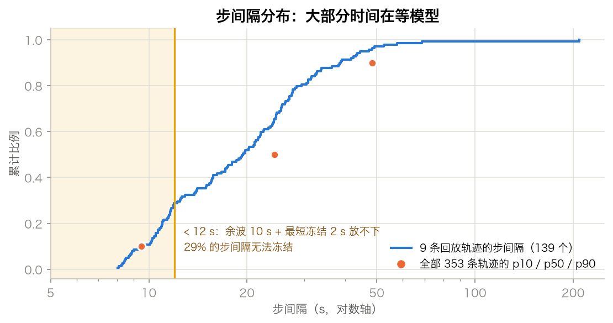

*图 1：9 条回放轨迹的步间隔累计分布（对数轴），橙点是全部 353 条轨迹的 p10、p50、p90。冻结要求步间隔超过约 12 s（10 s 余波加至少 2 s 冻结），约 29% 的步间隔达不到。*

`always` 策略随 N 的变化：

| N | 宿主已用内存均值（峰值）GiB | 每个桌面 PSS（p50）GiB | 宿主 CPU 均值（p95）核 | 启动阶段 / 全部启动后 CPU（核） | CPU PSI some avg10 均值 | 执行 p50 / p95 ms | 截图 p50 ms | 启动 p50 s |
|---:|---:|---:|---:|---:|---:|---:|---:|---:|
| 4 | 4.11（4.34） | 0.92 | 0.36（1.91） | 1.69 / 0.22 | 1.4% | 421 / 815 | 241 | 8.8 |
| 8 | 6.63（7.33） | 0.86 | 0.71（3.00） | 1.88 / 0.40 | 3.3% | 438 / 961 | 250 | 8.7 |
| 16 | 11.42（13.51） | 0.83 | 1.13（3.54） | 2.09 / 0.63 | 7.0% | 480 / 1,085 | 256 | 8.8 |

三种策略的对比：

| 指标 | `always` | `freeze` | `freeze-reclaim` |
|---|---|---|---|
| 宿主 CPU 均值，N=4 / 8 / 16（核） | 0.36 / 0.71 / 1.13 | 0.32 / 0.61 / 1.01 | 0.34 / 0.65 / 1.06 |
| 其中全部启动后，N=4 / 8 / 16（核） | 0.22 / 0.40 / 0.63 | 0.19 / 0.32 / 0.53 | 0.21 / 0.35 / 0.55 |
| 宿主已用内存均值，N=4 / 8 / 16（GiB） | 4.11 / 6.63 / 11.42 | 4.13 / 6.66 / 11.51 | 4.10 / 6.63 / 11.43 |
| swarm 文件页均值，N=4 / 8 / 16（GiB） | 1.90 / 2.35 / 2.94 | 1.90 / 2.33 / 2.92 | 0.41 / 0.66 / 1.01 |
| 执行 p50，N=4 / 8 / 16（ms） | 421 / 438 / 480 | 423 / 442 / 464 | 588 / 524 / 529 |
| 执行 p95，N=4 / 8 / 16（ms） | 815 / 961 / 1,085 | 802 / 969 / 997 | 948 / 1,088 / 1,181 |
| 冻结 p95 / 解冻 p50 / 解冻最大（ms） | – | 2.6–4.8 / 1.7–1.8 / 4.4 | 3.2–4.7 / 1.6–1.8 / 4.3 |
| 每次回收释放（均值）/ 耗时 p50 | – | – | 88–130 MiB / 33–36 ms |
| 每个实例被冻结的时间占比（均值） | – | 0.44–0.46 | 0.43–0.45 |

全部 9 轮共 1,377 步，`exec_ok` 失败、实例错误都是 0。`exec_ok` 只表示命令执行完毕，没有运行 OSWorld 评测器，所以不能说明任务结果与虚拟机回放或录制一致。各实例的冻结占比为 0.03–0.65，步间隔短的轨迹（gimp）几乎没有冻结机会。宿主采样中的冻结占比只有 0.26–0.29，因为已经回放完的实例在整轮结束前一直被算作"未冻结"。[逐轮汇总](results/desktop-swarm-summary.json) · [原始数据](results/raw/desktop-swarm-2026-11-19/)

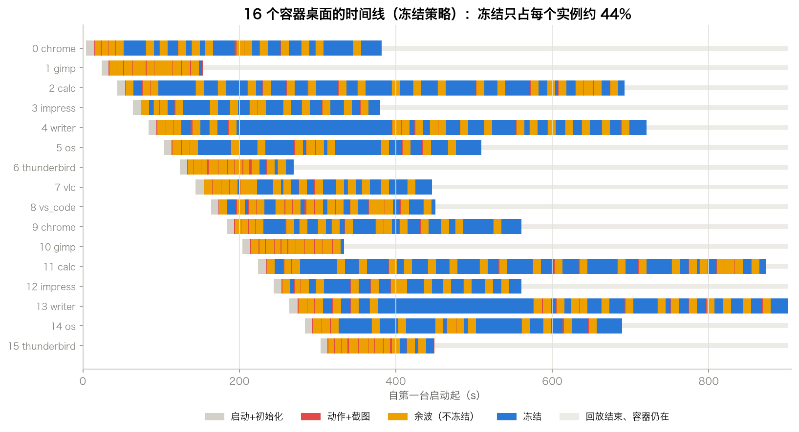

*图 2：N=16、冻结策略下每个实例的时间线。灰色是启动和初始化，红色是动作加截图，黄色是不冻结的余波期，蓝色是冻结，浅灰细条是回放结束后容器仍在运行的时间。gimp、thunderbird 的步间隔短，几乎没有蓝色。*

观察（测量结果）：

- **密度。** 从 N=4 到 16，每多一个桌面，宿主已用内存约增加 0.60–0.63 GiB，PSS 中位数从 0.92 降到 0.83 GiB。同一宿主上，虚拟机桌面每台 anon 峰值 3.1–3.8 GiB，按每个桌面的 PSS 算，容器桌面的密度约为虚拟机的 4 倍；按边际增量算，约为 5–6 倍。容器启动 8.4–10.1 s（p50），虚拟机 22–25 s。容器桌面省下的主要是虚拟机自己的内核、页缓存和"已触及的空闲页"；每个桌面的 PSS 里，私有内存约 0.73 GiB，摊到的共享页只有约 0.1 GiB（图 3）。

  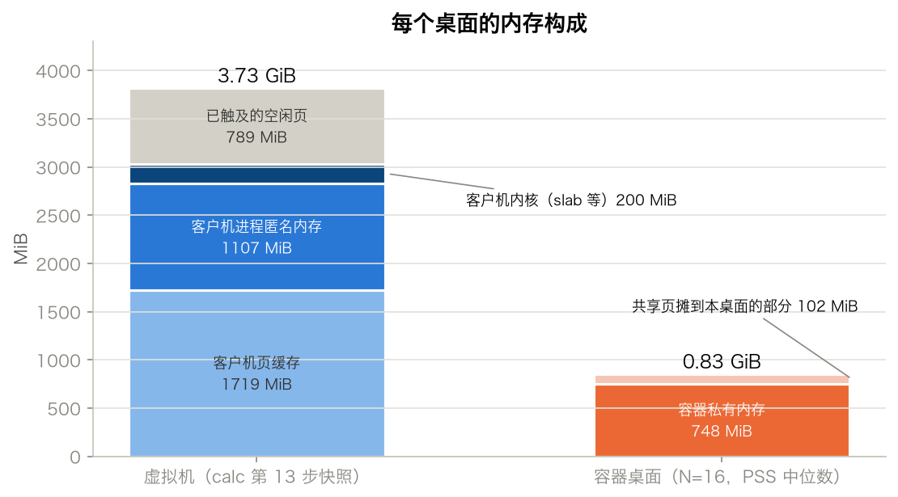

  *图 3：左边是虚拟机的内存成分（libreoffice_calc 第 13 步的单次快照，见上文"内存成分"），右边是 N=16 时容器桌面 PSS 的中位数，拆成私有内存和摊到的共享页。两者口径不同，左边是宿主为客户机保留的内存，右边是按比例分摊的进程内存，只能看量级。*
- **CPU 花在启动上，稳态很便宜。** 只要还有实例在启动，宿主 CPU 均值就有 1.7–2.1 核；全部启动之后，宿主只用 0.22–0.63 核，平均每个桌面 0.04–0.05 核（其中包括已经回放完、仍在空闲运行的实例）。N=16 时 3.54 核的 p95 和约 30% 的 CPU PSI 峰值都出现在启动阶段（图 7）。内存只用了 32 GB 中的 13.5 GiB，内存 PSI 一直为 0。此前版本据 p95 写"先到瓶颈的是 CPU"，那是把启动开销算进了回放窗口，现已更正。

  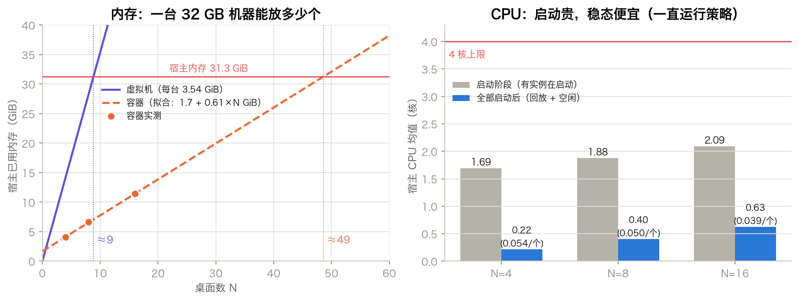

  *图 6：左边按实测点线性拟合宿主已用内存，外推一台 31.3 GiB 的宿主约能放 9 台虚拟机或约 49 个容器桌面（49 是外推，未实测）。右边是 `always` 策略下启动阶段与全部启动后的宿主 CPU。*

  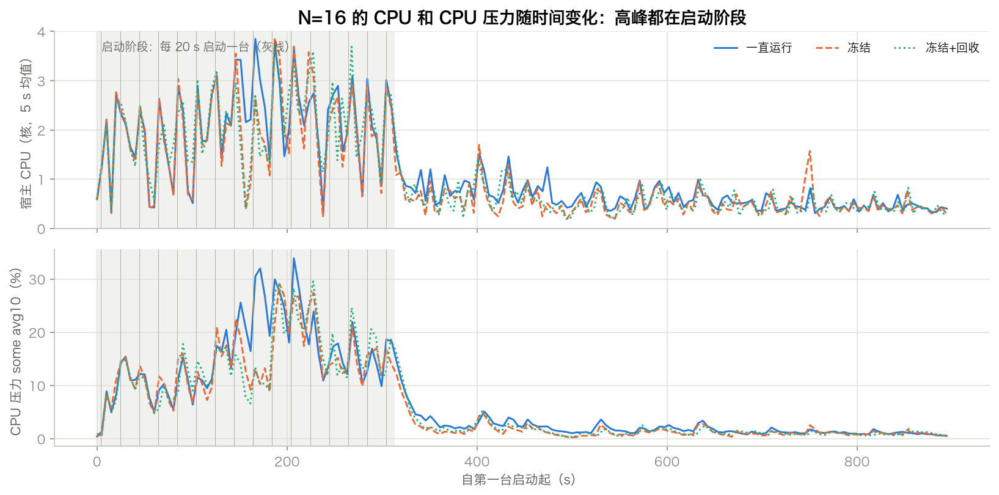

  *图 7：N=16 时宿主 CPU（5 s 均值）和 CPU PSI some avg10 随时间的变化，灰底是启动阶段，灰线是各实例开始启动的时刻。*
- **冻结。** 冻结和解冻都在毫秒级，没有引起执行失败。宿主 CPU 比 `always` 少 11–14%，只看全部启动后则少 14–20%；宿主内存不变。冻结不释放内存，这是预期的。
- **冻结加回收（无 swap）。**
  - 每次回收释放 88–130 MiB，几乎全是文件页：swarm 文件页均值从 1.9–2.9 GiB 降到 0.4–1.0 GiB，anon 不变。
  - 宿主已用内存没有变化，因为 `MemAvailable` 本来就把可回收的页缓存算作可用。
  - 代价是解冻后的下一步变慢：与 `always` 相比，执行 p50 增加 49–167 ms，p95 增加 96–133 ms。CPU 节省也从 11–14% 缩到 6–9%（全部启动后为 5–13%）。
  - 变慢与这次回收释放了多少只有弱相关（r = 0.18，图 5）。多数回收释放 0–200 MiB；释放 400 MiB 以上的多是每个实例第一次冻结时清掉的启动缓存。

  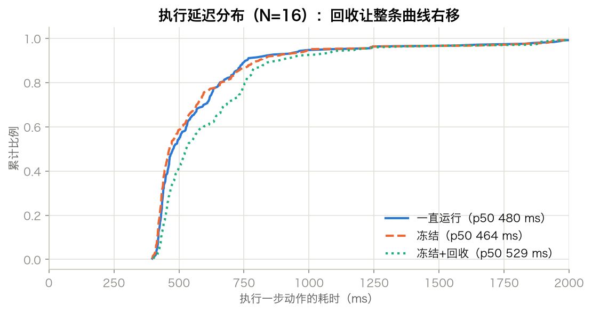

  *图 4：N=16 时三种策略执行一步动作的耗时分布（只含执行了命令的步骤）。*

  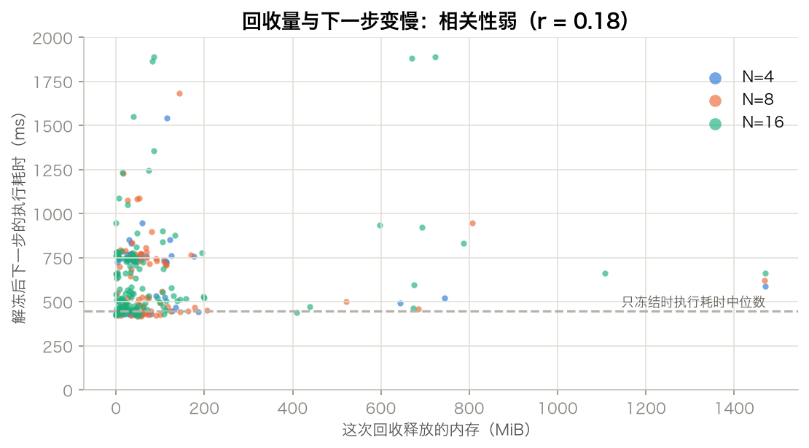

  *图 5：`freeze-reclaim` 下每次回收释放的内存与解冻后下一步执行耗时，虚线是 `freeze` 策略的执行耗时中位数。*

解读（待验证）：

- 在无 swap 的宿主上，`memory.reclaim` 只能丢掉文件页，并不提高密度；被丢掉的代码页和库页在下一个动作中重新读回，延迟随之上升。这是安卓做法照搬到 Linux 后出现的新问题：安卓的冻结后回收依赖 zram，把匿名内存压缩换出。要回收容器桌面的大头 anon（每个约 0.6 GiB），需要给宿主加 zram 或 swap，再测解冻后第一步的缺页延迟。DSec 也是这种组合（见研究计划中"移植方法的补充检索"一段，[同一节](research.md#两个候选方向的进一步核对)）。
- 变慢与回收量弱相关，说明决定代价的可能不是丢了多少页，而是丢的是不是下一步马上要用的页（代码页、字体、合成器的缓存）。第二轮的缺页和 refault 计数支持这一点，见下面"第二轮"。
- 冻结省下的 CPU 不多，因为回放的等待期中只有大约一半时间处于冻结状态，其余是 10 s 的余波期，而余波正是等待期 CPU 的主要来源。缩短余波期能多省 CPU，但有截到未完成画面的风险，这需要评测器验证。
- 容器桌面与虚拟机的回放是否同样忠实、GNOME 在容器中与在虚拟机中行为是否一致，都还没有检查。

**第二轮：逐进程采样（2026-11-20）。** 第一轮只有 cgroup 和宿主级计数，回答不了"解冻后为什么慢"和"CPU 花在哪些进程上"。第二轮在同一宿主、同一镜像、同样的 9 条轨迹上重跑了完整的 3×3 网格和 9 台虚拟机，只改了采样：

- 容器：宿主侧每 0.5 s 采一次宿主和各容器的 cgroup 计数，新增 `memory.stat` 中的主缺页和 `workingset_refault_file`、内存和 IO 的 PSI、`io.stat` 读字节数，以及 `/proc/vmstat`。同样每 0.5 s 读一次各容器内每个进程的 `/proc/<pid>/stat`（CPU 时间、缺页数、RSS），由 [procs.py](../sandweaver/procs.py) 在宿主上完成，不占容器内 CPU。
- 虚拟机：把同一个 procs.py 上传到客户机内，每 0.25 s 采一次全部进程。客户机时钟在回放前后各探测一次，按两次探测线性插值换算到宿主时钟。两次探测的偏移相差 0.13–1.5 s，所以虚拟机这边按阶段归属有亚秒级误差，动作期（每步约 1 s）受影响最大。
- 阶段划分：每一步分成"动作+截图"、动作后 10 s 的"余波"、之后的等待、冻结（仅冻结策略）、回放后的 120 s 空闲（仅虚拟机）。一个进程两次采样之间的增量归到这段时间中点所在的阶段。表中 CPU 是"该阶段内平均每个实例用多少核"。

脚本：[summarize-procs.py](../benchmarks/summarize-procs.py)（按进程和阶段归属）、[summarize-thaw-cost.py](../benchmarks/summarize-thaw-cost.py)（解冻后第一步的计数）、[plot-desktop-swarm-v2.py](../benchmarks/plot-desktop-swarm-v2.py)（图 8–11）。[汇总](results/desktop-swarm-v2-summary.json) · [原始数据](results/raw/desktop-swarm-v2-2026-11-20/)

*复现性。* 9 轮共 1,377 步，执行失败和实例错误仍为 0。内存、PSS、冻结占比与第一轮相差在 5% 以内，每次回收释放量相差在 6% 以内；全部启动后的宿主 CPU 为 0.23 / 0.39 / 0.69 核（`always`，N=4 / 8 / 16），第一轮是 0.22 / 0.40 / 0.63。执行 p50 相差 0–6%，p95 在 N=16 时高 3–24%（`freeze` 从 997 升到 1,234 ms）。每种配置仍只跑一次，p95 的差异分不清是采样开销还是两次运行之间的波动，所以上面各表保留第一轮的数，第二轮只用来解释机制。

*解冻后第一步付出了什么。* 下表只看紧跟在一次解冻之后、执行了命令的步骤；`always` 没有解冻，列的是全部命令步骤。计数取动作开始前最后一个采样到截图结束后第一个采样之间的差，窗口两端各可能多出不到 0.5 s。

| 解冻后第一步，N=4 / 8 / 16 | `always`（全部步骤） | `freeze` | `freeze-reclaim` |
|---|---|---|---|
| 步数 | 63 / 122 / 246 | 40 / 76 / 151 | 40 / 75 / 150 |
| 主缺页 p50 | 0 / 0 / 0 | 0 / 0 / 0 | 470 / 466 / 317 |
| 文件页 refault 均值 | 0 / 0 / 0 | 0 / 0 / 0 | 8,530 / 5,635 / 4,722 |
| 从磁盘读入均值（MiB） | 3.5 / 2.7 / 1.5 | 0.1 / 0.1 / 0.0 | 43.5 / 40.5 / 31.5 |
| IO 等待均值（ms） | 12.5 / 9.4 / 5.2 | 1.5 / 0.8 / 0.5 | 221 / 196 / 144 |
| 内存等待均值（ms） | 0 / 0 / 0 | 0 / 0 / 0 | 0 / 0 / 0 |
| 执行 p50（ms） | 417 / 444 / 505 | 415 / 429 / 462 | 627 / 586 / 588 |

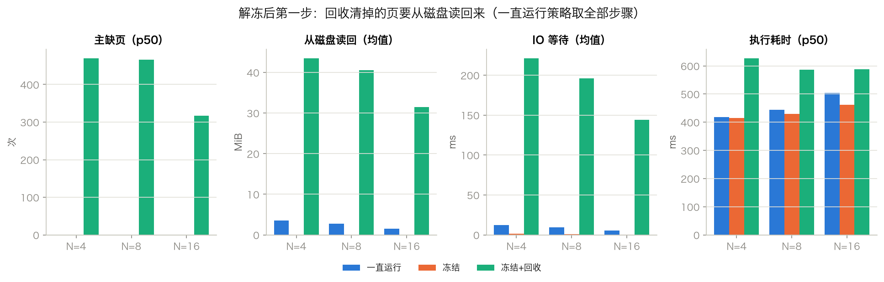

*图 9：解冻后第一步的主缺页、从磁盘读入量、IO 等待和执行耗时。`always` 没有解冻，取全部命令步骤。*

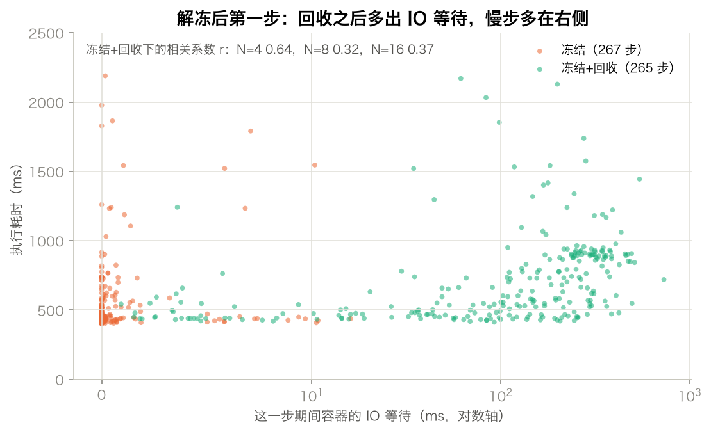

*图 10：`freeze` 和 `freeze-reclaim` 下解冻后第一步的 IO 等待（横轴，对数）与执行耗时，N=4、8、16 合并。*

- 只冻结不回收，解冻后的第一步几乎没有缺页和 IO，执行耗时与 `always` 相当甚至略低。冻结本身没有可测的恢复代价。
- 回收后，第一步平均要从磁盘读回 31–44 MiB、触发 300–470 次主缺页（p50），IO 等待 144–221 ms，这与执行 p50 比 `freeze` 下解冻后第一步多出的 126–212 ms 量级相当。内存 PSI 一直为 0：宿主内存充足，代价完全落在 IO 上，即"被清掉的页要重新读回"，而不是内存紧张。
- 第一步的执行耗时与 IO 等待的相关系数为 0.32–0.64，与读入量为 0.19–0.38，与上一次回收释放了多少为 −0.08–0.22。代价取决于下一步用到的页是否被清掉，而不是清掉了多少，这印证了上文的猜测。
- `freeze-reclaim` 下"非解冻后"的步骤也比 `always` 多读盘（18–34 MiB），说明一次回收后，读回要持续不止一步。
- 冻结期间测到每秒约 1 次主缺页（`freeze-reclaim`），应是阶段边界附近的采样被归入冻结期，不是冻结状态下真的缺页。

*CPU 花在哪些进程上。*

| 阶段（平均每个实例，核） | 容器，N=16 `always` | 虚拟机，9 台（客户机内） | 其中虚拟机的更新服务 | 其中虚拟机内的采样脚本 |
|---|---:|---:|---:|---:|
| 动作+截图 | 0.37 | 0.67 | 0.21 | 0.05 |
| 余波（动作后 10 s） | 0.08 | 0.34 | 0.15 | 0.04 |
| 之后的等待 | 0.03 | 0.10 | 0.02 | 0.04 |
| 冻结（N=16 `freeze`） | 0.002 | – | – | – |
| 回放后 120 s 空闲 | – | 0.07 | 0.01 | 0.04 |

"更新服务"指 packagekitd、snap-store、cnf-update-db、apt-check、snapd、fwupd、gnome-software、mandb 等 Ubuntu 后台检查或下载更新的进程。容器内的采样在宿主侧完成，不计入容器；虚拟机内的采样脚本自己约占 0.04 核，与整台空闲客户机的用量相当，比较时应扣掉。

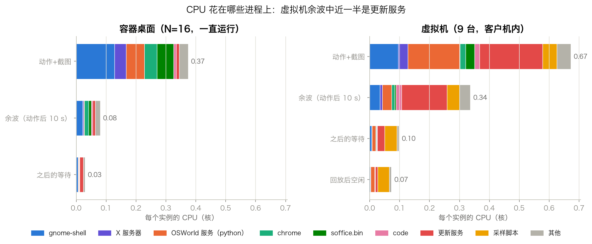

*图 8：容器（N=16，`always`）与虚拟机（9 台合并）在各阶段平均每个实例的 CPU，按进程拆分。*

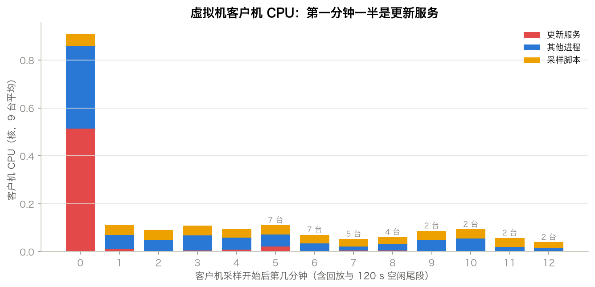

*图 11：9 台虚拟机客户机内逐分钟的 CPU，从客户机采样开始算起，拆成更新服务、采样脚本和其他进程；回放较短的虚拟机先结束，柱上标注仍在运行的台数。*

- 容器桌面：动作期的 CPU 主要是 gnome-shell（约 34%）、OSWorld 服务进程（python）、X 服务器和应用本身。余波期主要是 gnome-shell 和 chrome。余波之后每个实例只剩约 0.03 核，冻结后约 0.002 核。
- 虚拟机：客户机采样开始后的第一分钟平均用 0.91 核，其中 0.51 核是更新服务。这一分钟正好与前几步的余波重合，所以虚拟机余波比容器重的原因有很大一部分是开机后的更新任务，与动作无关：余波期 0.34 核中更新服务占 0.15 核（45%），采样脚本 0.04 核，剩下约 0.15 核才与容器的 0.08 核可比。第一分钟之后，客户机用 0.04–0.11 核（含采样脚本）。几分钟后出现的小高峰（"第二波"）是 apt-check、snapd、mandb、fstrim 这类定时任务。
- 阶段归属是按时间而不是按因果："余波"里的 CPU 只表示它发生在动作后 10 s 内。

解读（待验证）：

- 对容器桌面，冻结是安全的（无可测的恢复代价），回收在无 swap 时是净亏损：没有提高密度，却让下一步多付约 140–220 ms 的 IO 等待。若要回收，应该优先保留下一步会用到的页（例如只回收冷的文件页，或冻结前用 `memory.reclaim` 的较小目标），或者改用 zram 回收 anon。
- 虚拟机的开机后 CPU 可以通过在镜像中关掉 packagekit、snap 刷新和 apt 定时任务大幅降低。这不改变内存结论，只影响 CPU 和第一分钟的延迟，尚未测量。

**下一步。** 方案 B：用 Xvfb 加最小窗口管理器代替 GNOME，比较每个桌面的内存和 CPU；给宿主加 zram 后重测 `freeze-reclaim`，并试只回收部分文件页；在虚拟机镜像中关掉更新服务后重测 phase 1；对少量轨迹运行 OSWorld 评测器，检查冻结是否改变任务结果。

## 风险与限制

- SWE-bench 镜像多为 x86-64。实验机 `gpu-wsl`（WSL2 Arch Linux，x86-64，12 vCPU，约 7.9 GB 内存，有 `/dev/kvm`）已可用，并已在其上回放 SWE-bench Multilingual 轨迹（见 [SWE-bench Multilingual](swe-bench-multilingual.md)）。内存较小，大型构建任务需串行运行。
- 单模型、单 agent 框架、约 50 个任务，结论只适用于该组合。
- 模型客户端耗时含网络和 SDK，不等于服务端推理时间。
- RQ5 为估算；RQ4 的恢复成本依赖本机缓存状态，冷热缓存需分别报告。
- 本方案不评估跨租户安全隔离，复用完整性只记录可观测的残留状态。
